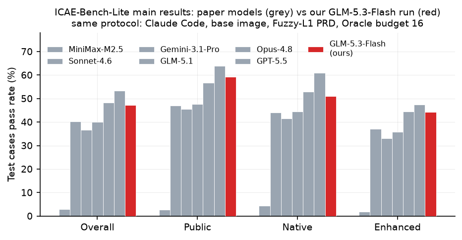
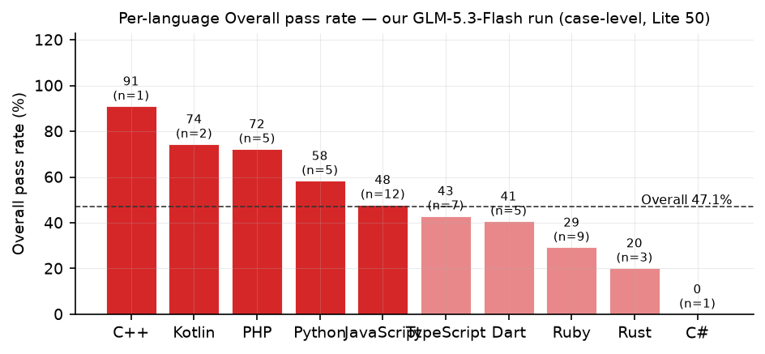
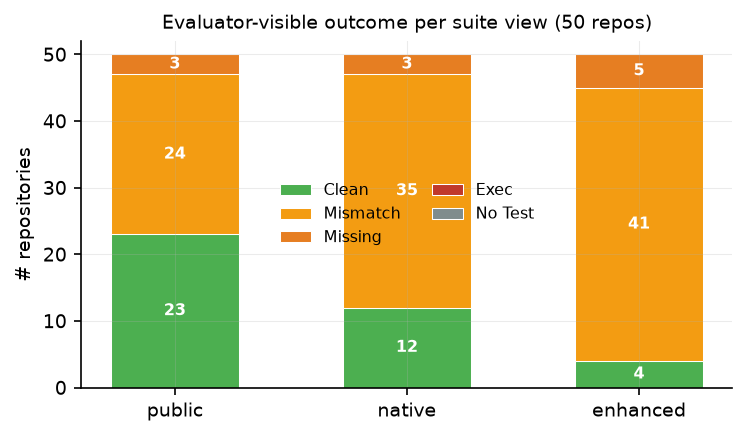
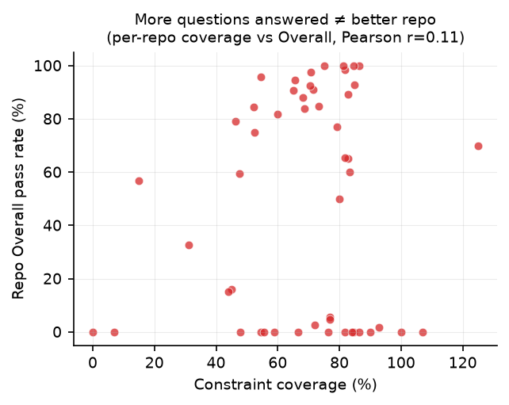

# GLM-5.3-Flash 在 ICAE-Bench-Lite 上的复现报告

> 运行日期：2026-09-18 ~ 09-19 ｜ append_id：`5b3b6db753be455aa9bc850574c68cd1`（`ICAE-EVAL/results/` 下）
> 协议：与论文 IV-B 主实验完全一致 —— Claude Code 框架、base 语言镜像、Fuzzy-L1 模糊 PRD、
> User Agent（Oracle）提问预算 16、adaptive thinking、评分四组全开。
> 数据：ICAE-Bench-Lite 全部 50 个任务（10 种语言），**50/50 生成成功、全部完成四组评分**。
> 模型：glm-5.3-flash（火山方舟 ark_code 端点，Anthropic 兼容协议；被测模型 / Critic / Oracle 路由同一端点）。

---

## 1. 主结果：论文 Table II 格式（Lite 50 任务）

| Model | Overall | Public | Native | Enhanced | Sem. | API | Design | File | LOC | Class | Method | Constr. | Fallback | Budget |
|---|---|---|---|---|---|---|---|---|---|---|---|---|---|---|
| GPT-5.5（论文） | **53.3** | **63.8** | **60.9** | **47.4** | 30.0 | 15.2 | 48.7 | 36.8 | 35.0 | 32.6 | 17.7 | **73.2** | 21.0 | 71.7 |
| Claude-Opus-4.8（论文） | 48.2 | 56.6 | 52.9 | 44.4 | 28.5 | 14.3 | 49.1 | 45.3 | 47.1 | 36.8 | 17.7 | 67.8 | **17.9** | 75.5 |
| **GLM-5.3-Flash（复现）** | **47.1** | 59.3 | 51.0 | 44.2 | **37.6** | **20.3** | **63.1** | 255.5 | 1328.4 | **36.6** | **19.9** | 67.8 | 25.8 | 90.7 |
| Claude-Sonnet-4.6（论文） | 40.2 | 47.0 | 44.1 | 37.1 | 34.2 | 16.1 | 44.3 | 33.9 | 51.0 | 34.9 | 18.4 | 60.8 | 25.9 | 75.1 |
| GLM-5.1（论文） | 40.0 | 47.6 | 44.5 | 35.9 | 22.6 | 11.0 | 37.9 | 32.4 | 64.5 | 33.2 | 17.4 | 63.3 | 28.4 | 95.4 |
| Gemini-3.1-Pro（论文） | 36.6 | 45.5 | 41.4 | 33.1 | 27.2 | 14.2 | 31.4 | 62.2 | 743.3 | 35.4 | 18.0 | 58.0 | 23.5 | 68.5 |
| MiniMax-M2.5（论文） | 2.8 | 2.7 | 4.4 | 1.9 | 19.2 | 8.2 | 28.6 | 17.9 | 32.5 | 30.8 | 12.6 | 48.1 | 28.1 | 69.1 |

> 口径与论文一致：Overall/Public/Native/Enhanced 为 case 级通过率（Overall=(Native+Enhanced 通过数)/(两者总数)，
> 本轮 case 总数：Public 815、Native 1203、Enhanced 1569）；其余为任务级宏平均；File/LOC 为生成/原始比值(%)，可超 100。

** headline：Overall 47.1%，在七个模型中排第 3**——与论文第一梯队（GPT-5.5 53.3、Opus-4.8 48.2）同一量级，
高于 Sonnet-4.6、GLM-5.1、Gemini-3.1-Pro。注意 GLM-5.1 → GLM-5.3-Flash 的跨代提升约 +7 分（40.0 → 47.1）。

## 2. 语言维度

- 强项：C++（91%，n=1）、Kotlin（74%，n=2）、PHP（72%）、Python（58%）
- 弱项：Ruby（29%，n=9）、Rust（20%，n=3）、C#（0%，n=1）
- 每语言样本量小（Lite 50 按 LOC 选任务），单语言结论仅供参考；但 Ruby 任务多且分低，明显拖累 Overall。

## 3. 失败模式（论文 Fig. failure-modes 同款分类）

- **Exec=0、No Test=0**：50 个仓库全部按规范交付了可运行的 `rcb_tests/test.sh` 并在全新容器中跑通——
  指令遵循和环境适应能力是七模型中最好的一档（论文里弱模型大量 No Test / Exec）。
- 失分几乎全部来自 **Mismatch（行为不符）**：public 24 / native 35 / enhanced 41 个仓库存在输出不符。
- 完全通过（Clean）的仓库：public 23 → native 12 → enhanced 4，**越隐藏、越边界，得分越差**。

## 4. 交互质量："问得多" ≠ "做得对"

- 约束覆盖率 67.8%（中游），预算使用率 90.7%（几乎用满 16 问，与 GLM-5.1 的 95.4 类似）。
- 逐仓库"覆盖率 vs Overall"的 Pearson r=**0.11**——**复现了论文的核心发现**：
  从 Oracle 问回多少约束几乎不能预测最终代码质量，瓶颈在信息组织与实现验证，不在检索。

## 5. 失分点分析

**（1）可见样例过拟合，边界行为不robust（与论文各模型一致）**
Public 59.3% vs Enhanced 44.2%，15 分落差。典型如增强用例 `total=0` vs 生成实现输出 `total=0.00`
（空购物车的数字格式边界）；再如 header 值尾部空格未按原文保留（`padded value␣␣`）。

**（2）隐藏接口契约偶发完全走偏**
15 个仓库 Overall 为 0，多数是输出契约层面偏离。例如 Ruby connection_pool（realcode@003）：
隐藏用例期望 `value=1`，实现输出 `results=`——整个 stdout 协议不对，而非局部 bug。
这类"协议级偏离"一旦发生就是整仓归零，是 Overall 的最大杀手。

**（3）CLI 参数解析等"需求没写、问了也难覆盖"的细节**
如 realcode@001（JS）：期望遍历打印 `amd/a.js...`，实现打印 `error=missing_filename`——
参数缺失时的行为分支与参考实现不同。这类细节即使 16 问用满也难以全部覆盖。

**（4）过度工程化倾向**
File 255.5% / LOC 1328.4%：生成代码规模是原仓库的 13 倍以上（七模型中最夸张，超过 Gemini 的 743%）。
论文的结论在这里同样成立：更多代码没有换来更高通过率，反而说明模型倾向"多写以图覆盖"，
而在黑盒评分下这既不得分也不加分。

**（5）动态语言的行为保真更难**
Ruby（9 个任务、29%）是最大失分面；静态/强类型语言（Kotlin、C++、PHP）反而最高。
与论文全量表的"语言无普适优势"结论一致，但本模型在动态语言上的行为细节（方法链、隐式转换、
异常文本）丢分尤其明显。

## 6. 与论文结果整合的注意事项

1. **单次运行**：每个任务只跑了一遍，没有方差估计；论文同样如此，但 Lite 排名与全量排名只有
   中等一致（论文报告 Spearman ρ=0.71），"第 3 名"不宜过度解读。
2. **模型代际不同**：论文的 GLM-5.1 ≠ 本轮的 GLM-5.3-Flash（更新、更快、默认开启 thinking），
   两者的对比反映的是模型演进 + 端点差异的总和。
3. **Critic 主观分仅作参考**：论文附录显示 critic 与人类评分仅中等相关（Pearson 0.37–0.47）。
   本轮 Sem/Design 全场最高，结合 LOC 1328% 看，Critic 有"给长代码打高分"的倾向。
4. **数据噪声**：realcode@028 因中断重跑导致交互日志合并，其 coverage 107% 为伪值
   （宏平均中影响 1/50）；已在聚合中按原值保留、在此声明。

## 7. 产物清单

| 文件 | 内容 |
|---|---|
| `comparison/comparison_table.md` | 论文 Table II 格式合并表（自动生成） |
| `comparison/paper_main_results.csv` | 论文六模型 Table I/II 数字（手工整理自论文） |
| `comparison/glm53flash_results.csv` | 本轮复现聚合行 |
| `comparison/figs/fig1~fig4*.png` | 上述四张图 |
| `comparison/figs/stats.json` | 图表底层数据（case 数、失败模式、相关系数） |
| `comparison/aggregate_results.py` / `charts.py` | 聚合与制图脚本（可复用于其他 append_id） |
| `ICAE-EVAL/results/5b3b6db7…/` | 原始运行：settings.json、每仓库代码、trajectory、_eval 评分产物、summary.md |

复现环境与两处必要适配（macOS TMPDIR、critic max_tokens/timeout、Oracle 统计字段兼容）见
`复现状态与操作手册.md`。
